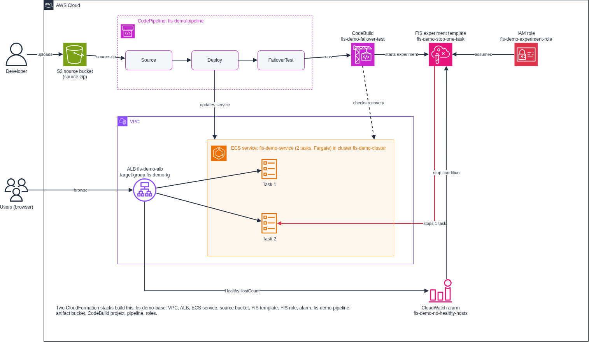

## Introduction

When a task in an ECS service stops, ECS starts a new one by itself. You do not have to do anything. The load balancer then sends traffic to the new task when it is healthy.

That is the design. But a design is a claim until you test it. These things can still go wrong:

- The new task cannot start. For example, the image cannot be pulled or a setting is missing.
- The new task starts but never passes the load balancer health check.
- The service recovers, but it takes longer than you can accept.
- The service runs only one task, so users see an outage while the replacement starts.

Most teams find these problems during a real outage. In this guide, you find them on every release instead.

You build a pipeline that does this:

1. It deploys the service.
2. It uses AWS Fault Injection Service (FIS) to stop one running task on purpose.
3. It waits, then checks that the service is back to its desired task count and that the load balancer shows all targets healthy.
4. If recovery takes longer than the time you set, the stage fails.

You will build it twice. First by hand in the AWS console, so you see every part. Then with two CloudFormation stacks.

The demo service runs plain nginx, so the test will pass. The demo shows how the pieces work. The test becomes useful when you point it at a real service.

What this test proves: the service recovers from a lost task within a time limit that you choose. What it does not prove: zero failed requests during the failure. It does not send traffic while the task is down.

## Architecture



- An S3 bucket holds `source.zip`. A change to this file starts the pipeline.
- CodePipeline has three stages: Source, Deploy, FailoverTest.
- The Deploy stage updates the ECS service.
- The FailoverTest stage runs a CodeBuild project. It starts the FIS experiment and checks recovery.
- The FIS experiment stops one task of `fis-demo-service`.
- A CloudWatch alarm watches the number of healthy targets. It is the experiment's stop condition.

The service runs 2 tasks. The experiment stops 1 of them, so one task stays up while ECS replaces the other.

## How the pieces fit

**Deploy and FailoverTest are two different jobs.** The Deploy stage is a normal release. It puts the new version on ECS. The FailoverTest stage runs after it and asks one question: does the service still recover if a task dies? It works like an integration test that runs after a deploy.

**What FIS does.** FIS is the tool that breaks the task. It stops one task and only one, because the target is set to select a count of 1. It uses its own IAM role, which can only stop tasks in this cluster, so the pipeline does not need broad ECS permissions to break things. It also keeps a record of each experiment.

You could stop a task with `aws ecs stop-task` and get the same failure. FIS adds the limited role, the record, and the stop condition. FIS is worth more with faults that run over time, such as CPU stress or network delay, because a stop condition can halt those. For this one action, the stop-condition alarm cannot undo a stopped task. The real safety control is the count of 1.

**Why CodeBuild is in the pipeline.** At the time of writing, I found no built-in CodePipeline action that starts a FIS experiment. So the FailoverTest stage runs a CodeBuild project, and CodeBuild runs a script. CodeBuild does not break anything itself. It gives the script a place to run, and it turns the result into pass or fail for the pipeline.

**What the script does.** CodeBuild reads `buildspec/run-fis-experiment.yml` from `source.zip`. That file runs `scripts/run-fis-experiment.sh`. The script has four steps. It exits with an error if any step fails.

1. Check before. It asks ECS how many tasks are running and asks the load balancer how many targets are healthy. Both must equal the desired count. If not, it stops. A service that was already broken should not be blamed on the test.
2. Start. It runs `aws fis start-experiment` with the experiment template ID. FIS stops one task.
3. Wait for the experiment. It checks the status every 10 seconds until the experiment is `completed`. If the status is `stopped`, `failed` or `cancelled`, or it takes more than 300 seconds, the script fails.
4. Wait for recovery. It keeps checking running tasks and healthy targets until both match the desired count again. If this takes longer than `RECOVERY_TIMEOUT` (300 seconds by default), the script fails. Otherwise it prints `The service recovered. Test passed.`

The script gets the template ID, cluster name, service name and target group ARN from environment variables on the CodeBuild project.

**When it runs.** The test runs on every pipeline run, after the Deploy stage succeeds. If Deploy fails, the test does not run. In this demo, a new `source.zip` in the S3 bucket starts the pipeline. In real use, point the test at a staging environment first. Stopping a task in production on every release is a decision your team should make on purpose.

## Before you start

You need:

- An AWS account and permission to create the resources below.
- AWS CLI v2 on your computer, signed in to your account.
- `zip` on your computer.
- A Region where FIS, ECS Fargate, CodePipeline and CodeBuild are available. Use the same Region for every step.

Cost: FIS charges per action-minute. At the time of writing, the price is $0.10 per action-minute. You also pay for the Fargate tasks, the load balancer and CodeBuild while they run. Delete everything when you finish (see Teardown).

Use these names exactly. The scripts and templates depend on them.

| Resource | Name |
|---|---|
| ECS cluster | `fis-demo-cluster` |
| ECS service | `fis-demo-service` |
| Task definition family | `fis-demo-task` |
| Container | `web` |
| Application Load Balancer | `fis-demo-alb` |
| Target group | `fis-demo-tg` |
| ALB security group | `fis-demo-alb-sg` |
| Task security group | `fis-demo-task-sg` |
| CloudWatch alarm | `fis-demo-no-healthy-hosts` |
| FIS IAM role | `fis-demo-experiment-role` |
| FIS experiment template name | `fis-demo-stop-one-task` |
| Source bucket | `fis-demo-source-<ACCOUNT_ID>-<REGION>` |
| CodeBuild project | `fis-demo-failover-test` |
| CodeBuild IAM role | `fis-demo-codebuild-role` |
| Pipeline | `fis-demo-pipeline` |

Get the code:

```bash
git clone https://github.com/Gbengard/aws-fis-failover-testing.git
cd aws-fis-failover-testing
```

## Manual approach in the AWS console

The manual path uses the default VPC. The CloudFormation path creates its own VPC.

### Part 1. Build the service

**Step 1. Create the security groups.**

1. Open the EC2 console. In the left menu, choose **Security Groups**, then choose **Create security group**.
2. Security group name: `fis-demo-alb-sg`. Description: `ALB for the FIS demo`. VPC: the default VPC.
3. Under **Inbound rules**, choose **Add rule**. Type: **HTTP**. Source: **Anywhere-IPv4**.
4. Choose **Create security group**.
5. Choose **Create security group** again. Name: `fis-demo-task-sg`. Description: `Tasks for the FIS demo`. VPC: the default VPC.
6. Under **Inbound rules**, choose **Add rule**. Type: **HTTP**. Source: **Custom**, then pick `fis-demo-alb-sg`.
7. Choose **Create security group**.

**Step 2. Create the target group.**

1. In the EC2 console, choose **Target Groups**, then **Create target group**.
2. Target type: **IP addresses**. Target group name: `fis-demo-tg`. Protocol: **HTTP**. Port: `80`. VPC: the default VPC.
3. Under **Health checks**, keep the path as `/`.
4. Choose **Next**. Do not register any targets. Choose **Create target group**.

**Step 3. Create the load balancer.**

1. In the EC2 console, choose **Load Balancers**, then **Create load balancer**.
2. Under **Application Load Balancer**, choose **Create**.
3. Load balancer name: `fis-demo-alb`. Scheme: **Internet-facing**. VPC: the default VPC.
4. Under **Mappings**, select at least two Availability Zones.
5. Under **Security groups**, remove the default group and select `fis-demo-alb-sg`.
6. Under **Listeners and routing**, keep **HTTP** and port `80`. For **Default action**, select `fis-demo-tg`.
7. Choose **Create load balancer**.

**Step 4. Create the cluster.**

1. Open the ECS console. Choose **Clusters**, then **Create cluster**.
2. Cluster name: `fis-demo-cluster`. Keep **AWS Fargate (serverless)** selected.
3. Choose **Create**.

**Step 5. Create the task execution role.**

ECS uses this role to pull the image and write logs.

1. Open the IAM console. Choose **Roles**, then **Create role**.
2. Trusted entity type: **Custom trust policy**. Paste this:

```json
{
  "Version": "2012-10-17",
  "Statement": [
    {
      "Effect": "Allow",
      "Principal": { "Service": "ecs-tasks.amazonaws.com" },
      "Action": "sts:AssumeRole"
    }
  ]
}
```

3. Choose **Next**. In the permissions list, search for `AmazonECSTaskExecutionRolePolicy` and select it. Choose **Next**.
4. Role name: `fis-demo-task-execution-role`. Choose **Create role**.

**Step 6. Create the task definition.**

1. In the ECS console, choose **Task definitions**, then **Create new task definition**.
2. Task definition family: `fis-demo-task`. Launch type: **AWS Fargate**. CPU: **.25 vCPU**. Memory: **.5 GB**.
3. Task execution role: choose `fis-demo-task-execution-role`.
4. Under **Container - 1**, set Name: `web`. Image URI: `public.ecr.aws/docker/library/nginx:latest`. Container port: `80`. Protocol: **TCP**.
5. Choose **Create**.

**Step 7. Create the service.**

1. Open `fis-demo-cluster`. On the **Services** tab, choose **Create**.
2. Under **Compute options**, choose **Launch type**, then **FARGATE**.
3. Under **Deployment configuration**, set Family: `fis-demo-task` (latest revision). Service name: `fis-demo-service`. Desired tasks: `2`.
4. Under **Networking**, keep the default VPC and subnets. Remove the default security group and select `fis-demo-task-sg`. Turn **Public IP** on.
5. Under **Load balancing**, choose **Application Load Balancer**. Choose **Use an existing load balancer** and select `fis-demo-alb`.
6. For the container, choose `web 80:80`. Choose **Use an existing listener** (`HTTP:80`) and **Use an existing target group** (`fis-demo-tg`).
7. Choose **Create**.

**Step 8. Check the service.**

1. Wait until the service shows 2 running tasks.
2. In the EC2 console, open `fis-demo-tg`. On the **Targets** tab, wait until both targets are **healthy**.
3. Open the ALB DNS name in your browser. You should see the nginx welcome page.

### Part 2. Add the FIS experiment

**Step 9. Create the CloudWatch alarm.**

1. Open the CloudWatch console. Choose **Alarms**, then **All alarms**, then **Create alarm**.
2. Choose **Select metric**. Choose **ApplicationELB**, then **Per AppELB, per TG Metrics**.
3. Select **HealthyHostCount** for `fis-demo-tg`. Choose **Select metric**.
4. Statistic: **Minimum**. Period: **1 minute**.
5. Conditions: **Static**, **Lower**, than `1`. Choose **Next**.
6. Remove any notification action. Choose **Next**.
7. Alarm name: `fis-demo-no-healthy-hosts`. Choose **Next**, then **Create alarm**.

**Step 10. Create the IAM role for FIS.**

1. Open the IAM console. Choose **Roles**, then **Create role**.
2. Trusted entity type: **Custom trust policy**. Paste this:

```json
{
  "Version": "2012-10-17",
  "Statement": [
    {
      "Effect": "Allow",
      "Principal": { "Service": "fis.amazonaws.com" },
      "Action": "sts:AssumeRole"
    }
  ]
}
```

3. Choose **Next**. Do not attach any policy. Choose **Next**.
4. Role name: `fis-demo-experiment-role`. Choose **Create role**.
5. Open the role. Choose **Add permissions**, then **Create inline policy**. Choose the **JSON** tab and paste this. Replace `<ACCOUNT_ID>` and `<REGION>`.

```json
{
  "Version": "2012-10-17",
  "Statement": [
    {
      "Effect": "Allow",
      "Action": ["ecs:DescribeTasks", "ecs:ListTasks", "tag:GetResources"],
      "Resource": "*"
    },
    {
      "Effect": "Allow",
      "Action": "ecs:StopTask",
      "Resource": "*",
      "Condition": {
        "ArnEquals": {
          "ecs:cluster": "arn:aws:ecs:<REGION>:<ACCOUNT_ID>:cluster/fis-demo-cluster"
        }
      }
    }
  ]
}
```

6. Choose **Next**. Policy name: `fis-demo-stop-task`. Choose **Create policy**.

**Step 11. Create the experiment template.**

1. Open the FIS console. Choose **Experiment templates**, then **Create experiment template**.
2. Description: `Stop one running task of the demo ECS service`. Name: `fis-demo-stop-one-task`.
3. Under **Actions**, choose **Add action**. Name: `StopOneTask`. Action type: `aws:ecs:stop-task`. Choose **Save**.
4. Under **Targets**, edit the target that FIS created for the action. Name: `OneTask`. Resource type: `aws:ecs:task`.
5. Set the target to use resource parameters: `cluster` = `fis-demo-cluster` and `service` = `fis-demo-service`.
6. Selection mode: **Count**. Number of resources: `1`. Choose **Save**.
7. Under **Service access**, choose **Use an existing IAM role** and select `fis-demo-experiment-role`.
8. Under **Stop conditions**, select the alarm `fis-demo-no-healthy-hosts`.
9. Choose **Create experiment template**. Type `create` when asked, then choose **Create experiment template**.

**Step 12. Run the experiment by hand.**

1. Open the template. Choose **Start experiment**. Type `start` when asked, then choose **Start experiment**.
2. Watch the experiment state change until it shows **Completed**.
3. In the ECS console, open `fis-demo-service`. On the **Tasks** tab, you see one task stopped and a new task starting.
4. In the target group, wait until both targets are **healthy** again.

The service recovered. Now put this check into a pipeline.

### Part 3. Add the pipeline

**Step 13. Create the buckets.**

1. Open the S3 console. Choose **Create bucket**.
2. Bucket name: `fis-demo-source-<ACCOUNT_ID>-<REGION>`.
3. Under **Bucket Versioning**, choose **Enable**.
4. Choose **Create bucket**.
5. Choose **Create bucket** again. Bucket name: `fis-demo-artifacts-<ACCOUNT_ID>-<REGION>`. Leave versioning off. Choose **Create bucket**.

The source bucket holds `source.zip`. The pipeline keeps its working files in the artifacts bucket.

**Step 14. Upload the source.**

From the repo folder, run:

```bash
bash tools/package-source.sh fis-demo-source-<ACCOUNT_ID>-<REGION>
```

This builds `source.zip` and uploads it. The zip has three files: `imagedefinitions.json`, `buildspec/run-fis-experiment.yml` and `scripts/run-fis-experiment.sh`.

**Step 15. Create the CodeBuild role.**

1. Open the IAM console. Choose **Roles**, then **Create role**.
2. Trusted entity type: **Custom trust policy**. Paste this:

```json
{
  "Version": "2012-10-17",
  "Statement": [
    {
      "Effect": "Allow",
      "Principal": { "Service": "codebuild.amazonaws.com" },
      "Action": "sts:AssumeRole"
    }
  ]
}
```

3. Choose **Next**. Do not attach any policy. Choose **Next**.
4. Role name: `fis-demo-codebuild-role`. Choose **Create role**.
5. Open the role. Choose **Add permissions**, then **Create inline policy**. Choose the **JSON** tab and paste this. Replace `<ACCOUNT_ID>`, `<REGION>` and `<TEMPLATE_ID>`. You get the template ID from the FIS console, on the experiment template page.

```json
{
  "Version": "2012-10-17",
  "Statement": [
    {
      "Effect": "Allow",
      "Action": [
        "logs:CreateLogGroup",
        "logs:CreateLogStream",
        "logs:PutLogEvents"
      ],
      "Resource": "arn:aws:logs:<REGION>:<ACCOUNT_ID>:log-group:/aws/codebuild/fis-demo-failover-test*"
    },
    {
      "Effect": "Allow",
      "Action": ["s3:GetObject", "s3:GetObjectVersion", "s3:PutObject"],
      "Resource": "arn:aws:s3:::fis-demo-artifacts-<ACCOUNT_ID>-<REGION>/*"
    },
    {
      "Effect": "Allow",
      "Action": "ecs:DescribeServices",
      "Resource": "*"
    },
    {
      "Effect": "Allow",
      "Action": "elasticloadbalancing:DescribeTargetHealth",
      "Resource": "*"
    },
    {
      "Effect": "Allow",
      "Action": "fis:StartExperiment",
      "Resource": [
        "arn:aws:fis:<REGION>:<ACCOUNT_ID>:experiment-template/<TEMPLATE_ID>",
        "arn:aws:fis:<REGION>:<ACCOUNT_ID>:experiment/*"
      ]
    },
    {
      "Effect": "Allow",
      "Action": "fis:GetExperiment",
      "Resource": "arn:aws:fis:<REGION>:<ACCOUNT_ID>:experiment/*"
    },
    {
      "Effect": "Allow",
      "Action": "iam:PassRole",
      "Resource": "arn:aws:iam::<ACCOUNT_ID>:role/fis-demo-experiment-role",
      "Condition": {
        "StringEquals": { "iam:PassedToService": "fis.amazonaws.com" }
      }
    },
    {
      "Effect": "Allow",
      "Action": "iam:CreateServiceLinkedRole",
      "Resource": "*",
      "Condition": {
        "StringLike": { "iam:AWSServiceName": "fis.amazonaws.com" }
      }
    }
  ]
}
```

6. Choose **Next**. Policy name: `fis-demo-codebuild-policy`. Choose **Create policy**.

**Step 16. Create the pipeline role.**

1. Open the IAM console. Choose **Roles**, then **Create role**.
2. Trusted entity type: **Custom trust policy**. Paste this:

```json
{
  "Version": "2012-10-17",
  "Statement": [
    {
      "Effect": "Allow",
      "Principal": { "Service": "codepipeline.amazonaws.com" },
      "Action": "sts:AssumeRole"
    }
  ]
}
```

3. Choose **Next**. Do not attach any policy. Choose **Next**.
4. Role name: `fis-demo-pipeline-role`. Choose **Create role**.
5. Open the role. Choose **Add permissions**, then **Create inline policy**. Choose the **JSON** tab and paste this. Replace `<ACCOUNT_ID>` and `<REGION>`.

```json
{
  "Version": "2012-10-17",
  "Statement": [
    {
      "Effect": "Allow",
      "Action": [
        "s3:GetObject",
        "s3:GetObjectVersion",
        "s3:GetBucketVersioning",
        "s3:GetBucketLocation",
        "s3:ListBucket",
        "s3:PutObject"
      ],
      "Resource": [
        "arn:aws:s3:::fis-demo-source-<ACCOUNT_ID>-<REGION>",
        "arn:aws:s3:::fis-demo-source-<ACCOUNT_ID>-<REGION>/*",
        "arn:aws:s3:::fis-demo-artifacts-<ACCOUNT_ID>-<REGION>",
        "arn:aws:s3:::fis-demo-artifacts-<ACCOUNT_ID>-<REGION>/*"
      ]
    },
    {
      "Effect": "Allow",
      "Action": ["codebuild:StartBuild", "codebuild:BatchGetBuilds"],
      "Resource": "arn:aws:codebuild:<REGION>:<ACCOUNT_ID>:project/fis-demo-failover-test"
    },
    {
      "Effect": "Allow",
      "Action": [
        "ecs:DescribeServices",
        "ecs:DescribeTaskDefinition",
        "ecs:DescribeTasks",
        "ecs:ListTasks",
        "ecs:RegisterTaskDefinition",
        "ecs:UpdateService"
      ],
      "Resource": "*"
    },
    {
      "Effect": "Allow",
      "Action": "iam:PassRole",
      "Resource": "arn:aws:iam::<ACCOUNT_ID>:role/fis-demo-task-execution-role",
      "Condition": {
        "StringEquals": { "iam:PassedToService": "ecs-tasks.amazonaws.com" }
      }
    }
  ]
}
```

6. Choose **Next**. Policy name: `fis-demo-pipeline-policy`. Choose **Create policy**.

**Step 17. Create the CodeBuild project.**

1. Open the CodeBuild console. Choose **Create project**.
2. Project name: `fis-demo-failover-test`.
3. Under **Source**, set Source provider to **Amazon S3**. The console does not list CodePipeline here. Set Bucket to `fis-demo-source-<ACCOUNT_ID>-<REGION>` and S3 object key to `source.zip`. When you add this project to the pipeline in Step 18, CodePipeline changes the project's source to CodePipeline for you.
4. Environment: **Managed image**. Use the latest Standard image that the console offers for Ubuntu.
5. Service role: **Existing service role**. Select `fis-demo-codebuild-role`.
6. Under **Buildspec**, choose **Use a buildspec file**. Buildspec name: `buildspec/run-fis-experiment.yml`.
7. Under **Additional configuration**, add four environment variables (type **Plaintext**):
   - `TEMPLATE_ID`: the experiment template ID from the FIS console.
   - `CLUSTER_NAME`: `fis-demo-cluster`
   - `SERVICE_NAME`: `fis-demo-service`
   - `TARGET_GROUP_ARN`: the full ARN of `fis-demo-tg`. Copy it from the target group's details page in the EC2 console. It starts with `arn:aws:elasticloadbalancing`. Do not use the name.
8. Choose **Create build project**.

**Step 18. Create the pipeline.**

1. Open the CodePipeline console. Choose **Create pipeline**. Choose the option to build a custom pipeline, then **Next**.
2. Pipeline name: `fis-demo-pipeline`. Service role: **Existing service role**. Select `fis-demo-pipeline-role`.
3. Under **Advanced settings**, set the artifact store to **Custom location** and select `fis-demo-artifacts-<ACCOUNT_ID>-<REGION>`. Choose **Next**.
4. Source provider: **Amazon S3**. Bucket: your source bucket. S3 object key: `source.zip`. Output artifact format: **CodePipeline default**. Choose **Next**.
5. Skip the build stage. Choose **Skip build stage**.
6. Deploy provider: **Amazon ECS**. Cluster name: `fis-demo-cluster`. Service name: `fis-demo-service`. Image definitions file: `imagedefinitions.json`. Choose **Next**, then **Create pipeline**.
7. Choose **Edit**. After the Deploy stage, choose **Add stage**. Stage name: `FailoverTest`. Choose **Add action group**.
8. Action name: `RunFisExperiment`. Action provider: **AWS CodeBuild**. Input artifacts: `SourceArtifact`. Project name: `fis-demo-failover-test`. Choose **Done**, then **Save**.

**Step 19. Run it.**

1. Choose **Release change** on the pipeline.
2. Watch the three stages. When FailoverTest succeeds, open the build logs. A passing run looks like this:

```text
Step 1: check the service is healthy before the test.
desired=2 running=2 healthy_targets=2
Step 2: start the experiment from template EXT2BR9MPSB8Hdix.
Experiment ID: EXPKoHXWhUDcXadYBt
Step 3: wait for the experiment to end.
experiment status: initiating
experiment status: running
experiment status: completed
Step 4: wait for the service to recover.
desired=2 running=1 healthy_targets=2
desired=2 running=1 healthy_targets=2
desired=2 running=1 healthy_targets=2
desired=2 running=1 healthy_targets=1
desired=2 running=1 healthy_targets=1
desired=2 running=2 healthy_targets=2
The service recovered. Test passed.
```

How to read it:

- Step 1 shows a healthy service: 2 tasks running and 2 healthy targets.
- In Step 3, FIS stops one task. The experiment goes from `initiating` to `running` to `completed`.
- In Step 4, the running count drops to 1 while ECS starts a replacement.
- The healthy target count can lag behind the running count. In this run it stayed at 2 for a few checks, then dropped to 1. That is why the script checks both numbers and not only the healthy targets.
- When both numbers are back at 2, the test passes.

In this run, the whole stage took about 100 seconds. Your IDs and timing will differ.

## Teardown for the manual approach

Delete in this order:

1. CodePipeline: choose `fis-demo-pipeline`, then **Delete pipeline**.
2. CodeBuild: choose `fis-demo-failover-test`, then **Delete build project**.
3. ECS: open `fis-demo-cluster`, choose `fis-demo-service`, then **Delete service**. Turn on **Force delete** if asked. Then choose **Delete cluster**.
4. EC2: delete the load balancer `fis-demo-alb`, then the target group `fis-demo-tg`, then the security groups `fis-demo-task-sg` and `fis-demo-alb-sg`.
5. FIS: delete the experiment template `fis-demo-stop-one-task`.
6. CloudWatch: delete the alarm `fis-demo-no-healthy-hosts`.
7. IAM: delete the four roles `fis-demo-experiment-role`, `fis-demo-codebuild-role`, `fis-demo-pipeline-role` and `fis-demo-task-execution-role`.
8. S3: empty and delete the source bucket and the artifacts bucket (`fis-demo-source-<ACCOUNT_ID>-<REGION>` and `fis-demo-artifacts-<ACCOUNT_ID>-<REGION>`). The source bucket is versioned, so use `bash tools/empty-bucket.sh <bucket-name>` first.
9. ECS: deregister the task definition `fis-demo-task`.

Do this before you start the automated approach. Both approaches use the same resource names, so leftover resources will cause name conflicts.

## Automated approach with CloudFormation

The automated path uses two stacks. The pipeline stack must wait, because the pipeline needs `source.zip` in the source bucket when it is created. That upload is a manual step, so it sits between the two stacks.

Template `01-base-stack.yaml` creates the VPC, the ALB, the ECS service, the source bucket, and the FIS parts: the alarm, the IAM role and the experiment template.

Template `02-pipeline-stack.yaml` creates the artifact bucket, the CodeBuild project, the IAM roles and the pipeline.

**Step 1. Deploy the base stack.**

```bash
aws cloudformation deploy \
  --template-file cloudformation/01-base-stack.yaml \
  --stack-name fis-demo-base \
  --capabilities CAPABILITY_NAMED_IAM
```

When it finishes, print the outputs:

```bash
aws cloudformation describe-stacks --stack-name fis-demo-base \
  --query "Stacks[0].Outputs" --output table
```

Open `AlbUrl` in your browser. You should see the nginx welcome page.

**Step 2. Upload the source.**

```bash
BUCKET=$(aws cloudformation describe-stacks --stack-name fis-demo-base \
  --query "Stacks[0].Outputs[?OutputKey=='SourceBucketName'].OutputValue" --output text)
bash tools/package-source.sh "$BUCKET"
```

**Step 3. Deploy the pipeline stack.**

```bash
aws cloudformation deploy \
  --template-file cloudformation/02-pipeline-stack.yaml \
  --stack-name fis-demo-pipeline \
  --capabilities CAPABILITY_NAMED_IAM
```

The pipeline starts by itself. In the CodePipeline console, open `fis-demo-pipeline` and watch the stages. When FailoverTest succeeds, open the CodeBuild logs. You should see `The service recovered. Test passed.`

**Step 4. See what the test does.**

Open the CodeBuild log of the FailoverTest stage. A passing run looks like this:

```text
Step 1: check the service is healthy before the test.
desired=2 running=2 healthy_targets=2
Step 2: start the experiment from template EXT2BR9MPSB8Hdix.
Experiment ID: EXPKoHXWhUDcXadYBt
Step 3: wait for the experiment to end.
experiment status: initiating
experiment status: running
experiment status: completed
Step 4: wait for the service to recover.
desired=2 running=1 healthy_targets=2
desired=2 running=1 healthy_targets=2
desired=2 running=1 healthy_targets=2
desired=2 running=1 healthy_targets=1
desired=2 running=1 healthy_targets=1
desired=2 running=2 healthy_targets=2
The service recovered. Test passed.
```

How to read it:

- Step 1 shows a healthy service: 2 tasks running and 2 healthy targets.
- In Step 3, FIS stops one task. The experiment goes from `initiating` to `running` to `completed`.
- In Step 4, the running count drops to 1 while ECS starts a replacement.
- The healthy target count can lag behind the running count. In this run it stayed at 2 for a few checks, then dropped to 1. That is why the script checks both numbers and not only the healthy targets.
- When both numbers are back at 2, the test passes.

In this run, the whole stage took about 100 seconds. Your IDs and timing will differ.

To change how long the test waits for recovery, set the environment variable `RECOVERY_TIMEOUT` (in seconds) on the CodeBuild project. The default is 300. This is your real pass or fail line.

## Teardown for the automated approach

Delete the pipeline stack first. The base stack exports values that it uses.

```bash
ACCOUNT=$(aws sts get-caller-identity --query Account --output text)
REGION=$(aws configure get region)

aws s3 rm "s3://fis-demo-artifacts-${ACCOUNT}-${REGION}" --recursive &&
aws cloudformation delete-stack --stack-name fis-demo-pipeline &&
aws cloudformation wait stack-delete-complete --stack-name fis-demo-pipeline &&
bash tools/empty-bucket.sh "fis-demo-source-${ACCOUNT}-${REGION}" &&
aws cloudformation delete-stack --stack-name fis-demo-base &&
aws cloudformation wait stack-delete-complete --stack-name fis-demo-base
```

The `&&` at the end of each line stops the chain at the first failure. That way the base stack is not deleted while its source bucket still has files in it.

## Troubleshooting

**The experiment fails right after it starts.**
FIS picks targets when the experiment starts. If it finds no matching tasks, the experiment fails. Check that the service has running tasks and that the cluster and service names in the target are exact.

**The experiment stops with an access error on `ecs:StopTask`.**
The FIS role needs `ecs:StopTask`. In the policy, the `ecs:cluster` condition must match your cluster ARN. To check if the condition is the cause, remove it and run the experiment again.

**The Source stage fails.**
The pipeline reads `source.zip` from the source bucket. Check that the file is there and that versioning is on for the bucket.

**FailoverTest fails with "The service is not healthy before the test."**
The script checks the service before it breaks anything. Wait until the Deploy stage has finished and both targets are healthy, then run the stage again.

**FailoverTest fails with "is not a valid target group ARN".**
The `TARGET_GROUP_ARN` variable holds the target group name, not its ARN. Edit the CodeBuild project, open **Additional configuration**, and paste the full ARN. The script now checks this at the start and tells you.

**FailoverTest shows `desired=None running=None`.**
ECS did not find the service. Check that `CLUSTER_NAME` is `fis-demo-cluster`, that `SERVICE_NAME` is `fis-demo-service`, and that the CodeBuild project is in the same Region as the service. To test from your computer, run `aws ecs describe-services --cluster fis-demo-cluster --services fis-demo-service --query "services[0].[runningCount,desiredCount]"`. The script now stops with a clear message in this case.

**FailoverTest fails with "not authorized to perform: iam:CreateServiceLinkedRole".**
FIS uses a service-linked role named `AWSServiceRoleForFIS`. If it does not exist in the account, FIS creates it when the first experiment starts, and the identity that starts the experiment needs permission to do that. Here, that identity is the CodeBuild role. Add `iam:CreateServiceLinkedRole` to the CodeBuild role, with the condition `iam:AWSServiceName` set to `fis.amazonaws.com`. The policy in this guide includes it. The error can also appear on a later run if someone deleted the service-linked role in between, for example during cleanup.

**FailoverTest fails with "did not recover".**
Recovery took longer than `RECOVERY_TIMEOUT`. Open the ECS service events and the target group health to see why. Raise the timeout only if the longer time is acceptable for your service.

**The stack delete fails with "bucket is not empty".**
Run `bash tools/empty-bucket.sh <bucket-name>` for the source bucket, or `aws s3 rm --recursive` for the artifact bucket, and delete again.

**The base stack delete fails because an export is in use.**
Delete the `fis-demo-pipeline` stack first.

## Conclusion

You now have a pipeline that breaks one task on purpose and checks that the service comes back. The test is small, but it turns a design claim into a check that runs on every release.

The full code is in the repo: https://github.com/Gbengard/aws-fis-failover-testing
